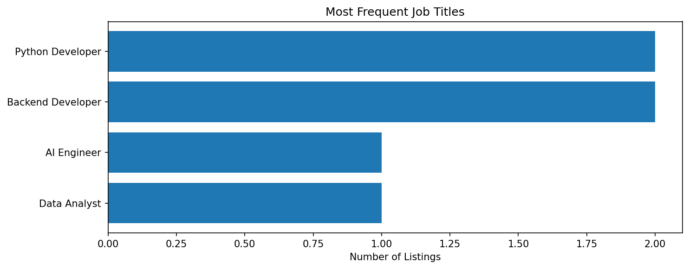
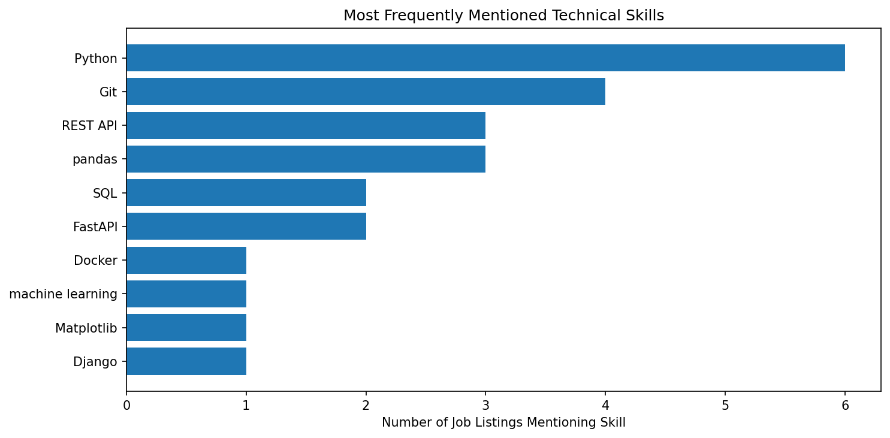

# Job Market Intelligence Analyzer

A Python-based data analysis project that explores job market trends by analyzing job listings, identifying popular job titles and locations, and counting the technical skills mentioned in job descriptions.

The project supports both a fictional sample dataset and live job listings from the Remotive public API.

## Features

- **Sample Data Analysis:** Analyze fictional job listings included in the repository.
- **Live Job Data:** Fetch job listings from the Remotive public API.
- **Data Cleaning:** Handle missing values, standardize text fields, and remove duplicate or invalid listings.
- **Job Market Analysis:** Summarize popular job titles, companies, and locations.
- **Technical Skill Analysis:** Count listings mentioning predefined technical skills.
- **Data Visualization:** Generate bar charts for job-title and technical-skill frequencies.
- **Export Results:** Save cleaned data and analysis summaries as CSV files.
- **Automated Testing:** Validate important data-cleaning and analysis behavior using Python's `unittest` framework.

## Sample Visualizations

The following charts show results from the included fictional sample dataset of six job listings. They demonstrate how the application summarizes job titles and technical skills; they do not represent the entire job market.

### Job Title Frequency



### Technical Skill Frequency



## Tech Stack

- Python
- pandas
- Requests
- Matplotlib
- unittest
- Ruff
- Git and GitHub

## Project Structure

```text
job-market-intelligence-analyzer/
├── data/
│   └── sample_jobs.csv
├── outputs/
│   └── .gitkeep
├── src/
│   ├── __init__.py
│   ├── analyzer.py
│   ├── data_cleaner.py
│   ├── data_loader.py
│   └── visualizer.py
├── tests/
│   └── test_pipeline.py
├── .gitignore
├── main.py
└── requirements.txt
```

Generated analysis files and charts are saved in `outputs/` when the application runs. They are excluded from Git by default.

## Getting Started

### Prerequisites

- Python 3
- Git
- An internet connection for live data retrieval

### 1. Clone the repository

After this project is published on GitHub, replace `YOUR_USERNAME` with your GitHub username.

```bash
git clone https://github.com/Harshit-Swain-25/job-market-intelligence-analyzer.git
cd job-market-intelligence-analyzer
```

Alternatively, if you already have the project locally, open its root directory in your terminal.

### 2. Create a virtual environment

```bash
python3 -m venv .venv
```

Activate it on macOS or Linux:

```bash
source .venv/bin/activate
```

### 3. Install dependencies

```bash
python -m pip install -r requirements.txt
```

## Usage

### Analyze the sample dataset

Run the application without any arguments:

```bash
python main.py
```

This uses the fictional job listings in `data/sample_jobs.csv`.

### Analyze live job listings

Run:

```bash
python main.py --live
```

This attempts to retrieve job listings from the Remotive public API. If live retrieval fails, the application falls back to the fictional sample dataset.

An internet connection is required for live data retrieval.

**Important:** Live listings may change over time. The results depend on the data returned by the API when the application runs.

## Output Files

After a successful analysis, the application generates the following files in `outputs/`:

| File | Description |
|---|---|
| `cleaned_jobs.csv` | Cleaned job listing dataset |
| `job_titles.csv` | Job-title frequency summary |
| `companies.csv` | Company frequency summary |
| `locations.csv` | Location frequency summary |
| `skills.csv` | Technical-skill frequency summary |
| `job_title_frequency.png` | Job-title frequency chart |
| `technical_skill_frequency.png` | Technical-skill frequency chart |
| `remotive_jobs.json` | Normalized live listings saved when retrieval from Remotive succeeds |

The live JSON file is generated by live mode. These output files are excluded from version control by default.

## Technical Skill Analysis

The analyzer searches job descriptions for a predefined list of technical skills, including:

- Python
- JavaScript
- FastAPI
- Django
- Flask
- pandas
- NumPy
- Matplotlib
- SQL
- Git
- Docker
- REST API
- Machine Learning

The analysis counts how many job listings mention each skill. A skill is counted at most once per listing, even if it appears multiple times in that listing.

These counts represent mentions in the analyzed dataset, not the entire job market.

## Run Tests

Execute the automated test suite from the project root:

```bash
python -m unittest discover -s tests -v
```

Run the code-quality checks with Ruff:

```bash
ruff check .
```

## Data Sources and Attribution

The included `data/sample_jobs.csv` file is intended for demonstration and uses fictional sample listings.

Live data is retrieved from the [Remotive public API](https://remotive.com/remote-jobs/api).

When using or displaying Remotive job listings, provide appropriate attribution to Remotive and link users to the original job listings. Review the current [Remotive API documentation](https://remotive.com/remote-jobs/api) and applicable terms before redistributing live data or deploying a public-facing dashboard.

## Limitations

- Analysis is limited to the listings available in the selected dataset.
- Skill detection uses predefined text matching rather than advanced semantic analysis.
- Job-title, company, and location counts depend on how the source data is written.
- Live API availability and returned listings may vary.
- The project provides descriptive analysis and does not predict hiring trends or guarantee job availability.

## Future Improvements

Potential extensions include:

- Adding interactive visualizations.
- Introducing job-search filters.
- Building a simple web interface.
- Comparing skill demand across job categories.
- Adding more robust tests for API failures and edge cases.

## License

A license has not yet been specified. Add an appropriate license before granting others permission to reuse or redistribute this project.
